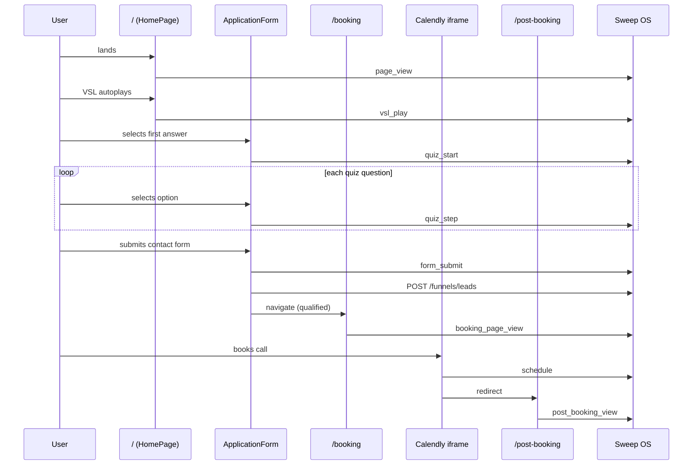

# Elite Player Academy — Funnel Events

Reference for aligning **Sweep OS → Funnels → Steps** with this site's tracking implementation. Event names are case-sensitive and must match exactly.

**Code source of truth:** `src/lib/sweepTracking.ts`  
**Implementation:** `POST {VITE_API_BASE_URL}/funnels/events` and `POST {VITE_API_BASE_URL}/funnels/leads`

---

## Config

| Setting | Value |
|---------|-------|
| Funnel ID | `af2f3b22-0ab4-40c1-8ba0-5240df806677` |
| API base URL | `https://api.sweepai.site` (override via `VITE_API_BASE_URL`) |
| Visitor ID | `localStorage.sweep_visitor_id` — stable across visits |
| Session ID | `sessionStorage.sweep_session_id` — new per tab/session |

Every event payload also includes auto-attached metadata: `page_url`, `page_title`, `referrer`, `event_timestamp`.

---

## Funnel shape

```text
/  (Home — VSL + inline application)
  → /booking  (Calendly embed)
    → /post-booking  (welcome VSL + FAQs)
```

Supporting pages (`/about`, `/contact`, `/privacy`, `/terms`) are **not** tracked — they sit outside the conversion funnel.

---

## Step order (Sweep OS Steps tab)

Add rows **in this order** so Sweep analytics shows a clean top-to-bottom conversion funnel:

| # | Step label (display) | `event_name` | Required |
|---|----------------------|--------------|----------|
| 1 | Landing page view | `page_view` | Yes |
| 2 | VSL play | `vsl_play` | Yes |
| 3 | Quiz started | `quiz_start` | Yes |
| 4 | Quiz step answered | `quiz_step` | Yes |
| 5 | Application submitted | `form_submit` | Yes |
| 6 | Booking page view | `booking_page_view` | Yes |
| 7 | Call scheduled | `schedule` | Yes |
| 8 | Post-booking page view | `post_booking_view` | Yes |

Do not rename or reorder without updating `EVENTS` in `sweepTracking.ts` and redeploying.

---

## Event sequence (happy path)



---

## Event reference

### 1. `page_view`

| | |
|---|---|
| **When** | User loads `/` (home funnel page) |
| **Where** | `src/pages/HomePage.tsx` — `useEffect` on mount |
| **Idempotent** | No |
| **Metadata** | `{ page: "home" }` |

Top-of-funnel entry. One fire per home page mount (new session or hard refresh).

---

### 2. `vsl_play`

| | |
|---|---|
| **When** | VSL iframe mounts (autoplay muted embed) |
| **Where** | `src/components/VSLPlayer.tsx` — `useEffect` on mount |
| **Idempotent** | No |
| **Metadata** | `{ placement: "funnel", video_id: "<vimeo-id>" }` |

Current VSL: Vimeo `1205640310` (`src/data/videos.ts`). Fires once per player mount, not on pause/seek.

---

### 3. `quiz_start`

| | |
|---|---|
| **When** | User selects their **first** quiz answer (not on page load — form is inline and visible) |
| **Where** | `src/components/ApplicationForm.tsx` — `ensureStarted()` |
| **Idempotent** | No (guarded by local `started` state — fires once per form session) |
| **Metadata** | `{ form_id: "epa-application" }` |

Signals intent to apply. Do not move this to page load; inline form would inflate starts.

---

### 4. `quiz_step`

| | |
|---|---|
| **When** | User selects an option on any quiz question (including re-select on same step) |
| **Where** | `src/components/ApplicationForm.tsx` — `selectOption()` |
| **Idempotent** | No |
| **Metadata** | `{ step: "<step_id>", answer: "<option_code>" }` |

**Quiz step IDs** (in order):

| Order | `step` value | Question |
|-------|--------------|----------|
| 1 | `playing_level` | Where are you now? |
| 2 | `goals` | Primary goal |
| 3 | `struggle` | Biggest challenge |
| 4 | `investment` | Investment level (DQ gate) |

**Answer codes** are defined in `src/data/applicationForm.ts`. The `investment` step drives disqualification:

| Code | Disqualifies |
|------|--------------|
| `just_curious` | Yes |
| `yes_sign_up`, `potentially_learn_more` | No |

Use `quiz_step` counts in Sweep to diagnose drop-off per question. Filter metadata `step = investment` + `answer = under_100` for DQ volume.

---

### 5. `form_submit`

| | |
|---|---|
| **When** | User submits the contact step (player name, email, age) |
| **Where** | `src/components/ApplicationForm.tsx` — `handleSubmit()` |
| **Idempotent** | **Yes** — key: `form_submit_{timestamp}` |
| **Metadata** | `{ form_id: "epa-application", disqualified: boolean, answers: { ...all quiz codes } }` |

Fires **before** lead API call. Always paired with `submitLead()` on the same submit.

**Post-submit routing:**

| `disqualified` | Destination |
|----------------|-------------|
| `false` | `/booking` |
| `true` | In-form DQ slide with YouTube CTA (no redirect) |

Both paths still fire `form_submit` and create/update a Client Board lead — filter on `metadata.disqualified` or `quiz_answers.disqualified` for qualified-only metrics.

---

### 6. `booking_page_view`

| | |
|---|---|
| **When** | User loads `/booking` |
| **Where** | `src/pages/BookingPage.tsx` — `useEffect` on mount |
| **Idempotent** | No |
| **Metadata** | `{ page: "booking" }` |

Only reached by qualified applicants (`disqualified: false`). Key conversion step between application and schedule.

---

### 7. `schedule`

| | |
|---|---|
| **When** | Calendly fires `calendly.event_scheduled` postMessage |
| **Where** | `src/components/BookingWidget.tsx` — `window.message` listener |
| **Idempotent** | **Yes** — key: `schedule_{timestamp}` |
| **Metadata** | `{}` (empty — Calendly payload not forwarded yet) |

On success, user redirects to `/post-booking`. Requires Calendly embed (`VITE_BOOKING_EMBED_URL` or default `https://calendly.com/ky-epacademy/epa`).

---

### 8. `post_booking_view`

| | |
|---|---|
| **When** | User loads `/post-booking` |
| **Where** | `src/pages/PostBookingPage.tsx` — `useEffect` on mount |
| **Idempotent** | No |
| **Metadata** | `{ page: "post-booking" }` |

Bottom-of-funnel confirmation. Post-booking welcome VSL (YouTube) does **not** emit a separate event.

---

## Lead capture (`POST /funnels/leads`)

Fires on application submit, same moment as `form_submit`.

| Field | Source |
|-------|--------|
| `funnel_id` | env / default UUID |
| `name` | Player name |
| `email` | Player email |
| `notes` | `Parent/guardian: {parentName}` when provided |
| `source` | `"quiz"` |
| `funnel_step_reached` | `"form_submit"` |
| `quiz_answers` | All quiz codes + `age` + `disqualified` boolean |

New clients land on Client Board as `lifecycle_state: "qualified"`. Existing emails merge/update.

**Optimal data:** Keep `quiz_answers` codes stable — they feed AI health scoring in Sweep. Do not send display labels instead of codes.

---

## Conversion metrics (Sweep OS)

Use this funnel for drop-off analysis:

```text
page_view
  → vsl_play          (VSL engagement rate)
  → quiz_start        (apply intent)
  → quiz_step ×4      (per-question completion — use metadata.step)
  → form_submit       (applications; split by disqualified)
  → booking_page_view (qualified reach booking)
  → schedule          (calls booked)
  → post_booking_view (post-booking confirmation)
```

**Suggested KPIs:**

| Metric | Numerator | Denominator |
|--------|-----------|-------------|
| VSL engagement | `vsl_play` | `page_view` |
| Apply rate | `quiz_start` | `page_view` |
| Application completion | `form_submit` | `quiz_start` |
| Qualification rate | `form_submit` where `disqualified=false` | `form_submit` |
| Booking reach | `booking_page_view` | qualified `form_submit` |
| Schedule rate | `schedule` | `booking_page_view` |
| Full funnel | `schedule` | `page_view` |

---

## Not tracked (by design)

| Page / action | Reason |
|---------------|--------|
| `/about`, `/contact`, `/privacy`, `/terms` | Support/legal — outside paid funnel |
| Post-booking YouTube VSL | No separate step configured |
| Sticky apply bar scroll | UX only — quiz_start fires on first answer |
| FAQ expand/collapse | Engagement, not funnel step |
| Video testimonial play | Social proof, not funnel step |

Add new steps in Sweep OS **and** code before tracking these.

---

## Verification checklist

1. **Sweep OS → Funnels → Steps** — all 8 `event_name` rows exist in order above.
2. **Sweep OS → Funnels → Overview** — Funnel ID matches env.
3. Local test flow: home → answer quiz → submit → book on Calendly → land on post-booking.
4. **Funnel → Health** — last event time updates after test.
5. **Funnel → Analytics** — step counts populate (~60s delay).
6. **Client Board** — test lead appears after `form_submit`.
7. **Idempotency** — double-submit form returns `status: "duplicate"` for `form_submit`, not duplicate rows.

Quick curl (replace visitor/session as needed):

```bash
curl -sS -X POST "https://api.sweepai.site/funnels/events" \
  -H "Content-Type: application/json" \
  -d '{
    "funnel_id": "af2f3b22-0ab4-40c1-8ba0-5240df806677",
    "event_name": "page_view",
    "visitor_id": "test_visitor",
    "session_id": "test_session",
    "metadata": { "page": "home" }
  }'
```

Expected: `202` with `"status": "accepted"`.

---

## Change protocol

1. Update `EVENTS` in `src/lib/sweepTracking.ts`.
2. Update firing code at the referenced component/page.
3. Add/rename matching row in Sweep OS Steps tab.
4. Update this doc.
5. Redeploy and run verification checklist.

Never guess event names in Sweep OS — mismatched names won't appear in analytics.
